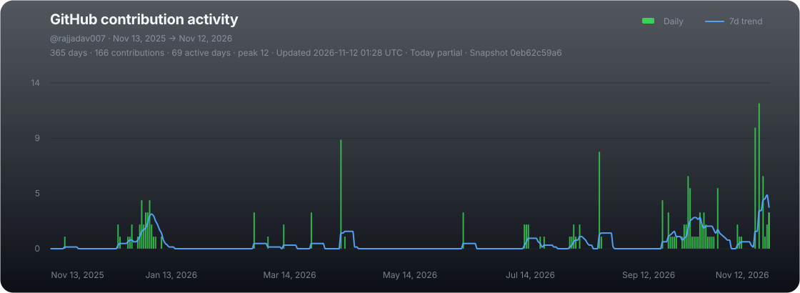

<!-- ================= FUTURISTIC HEADER ================= -->

  

<!-- ================= INTRODUCTION ================= -->

<h3 align="center">Hi, I'm Raj Jadav 👋</h3>

  

  Building intelligent applications using Artificial Intelligence, Machine Learning, Deep Learning and Generative AI.

  🎓 M.Sc. Data Science &nbsp; • &nbsp; 🤖 AI Enthusiast &nbsp; • &nbsp; 🚀 Problem Solver

  
  
  

---

### 👨‍💻 About Me

- 🎓 Currently pursuing M.Sc. Data Science at REVA University.
- 🤖 Interested in Artificial Intelligence, Machine Learning and Generative AI.
- 🧠 Exploring Large Language Models, RAG and AI Agents.
- ⚡ Building AI-powered applications for real-world problems.
- 🏆 Hackathon participant with experience in collaborative product development.
- 🌱 Continuously learning and experimenting with emerging AI technologies.
- 🎯 Aspiring to become an AI Engineer.

---

### 🛠️ Tech Stack

**Programming Languages**

**AI / Machine Learning**

**Generative AI & AI Engineering**

**Backend & Databases**

**Tools & Platforms**

---

### 📊 GitHub Statistics

  
  

---

<!-- CONTRIBUTION ACTIVITY -->
<h3 align="center">📈 My GitHub Contribution Activity</h3>

  

---

## ⏱️ WakaTime Coding Activity

  

---

### 🏆 GitHub Achievements

  

---

### 🐍 Contribution Snake

  

---

### 🤝 Connect With Me

  
  

  Building intelligent solutions, one commit at a time. 🚀

